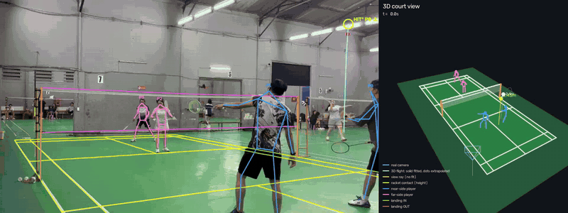

# badminton-system

Everything my badminton group runs on, in one repo: **AI video analysis**, a score counter
on the wrist, a court-availability tracker, and the shared bill book.



▶ Sharper version: [analysis/docs/demo.mp4](analysis/docs/demo.mp4)

**Left** — the original video with the reconstructed court, player skeletons, the shuttle trail
(red), the 3D flight projected back onto the image (blue: solid = observed, dotted =
extrapolated) and racket contacts (`HIT`, `HIT*` = a missed hit recovered by physics).
**Right** — the 3D scene: court, net, the real camera position, 3D players, the shuttle's flight
with its height, contact points and landing spots.

---

## Video analysis — [`analysis/`](analysis/)

From **one phone on a tripod**, no special hardware:

| Step | How |
|---|---|
| Court & camera | Camera intrinsics + pose (K, R, t) by fitting the BWF court model to the white lines |
| Shuttle | [TrackNetV3](https://github.com/alenzenx/TrackNetV3) finds every candidate, multi-target tracking picks the real flight |
| Players | YOLOX-x + RTMPose-x (rtmlib) 2D pose; feet on the floor homography give each player's court position, every keypoint is lifted to 3D |
| Hits | A sharp turn or speed-up of the shuttle whose view ray passes close to a player's wrist — gives contact height too; same side can't hit twice in a row |
| 3D flight | Each shot is fitted with shuttlecock physics (gravity + quadratic drag, Vinf ≈ 6.7 m/s); gravity supplies the metric scale one camera lacks |
| Landing | Flight ending while falling + a small white blob lying still at its end → landing point, IN/OUT |

Runs headless on a GPU box — a 2–2.5 min 720p clip takes roughly 10 minutes on an RTX 5060 Ti,
most of it pose estimation. Details, algorithms and accuracy notes:
[analysis/README.md](analysis/README.md) *(Vietnamese)*.

## What else is in here

| Folder | What | Runs on |
|---|---|---|
| [`analysis/`](analysis/) | Video → court, shuttle, hits, 3D flight | PC with GPU |
| [`watch/band/`](watch/) | Score counter app for the **Xiaomi Mi Band 10** (Vela QuickApp) | the band |
| [`watch/phone/`](watch/) | Flutter companion: scoreboard, voice announcer, hype sounds, match recording | Android phone |
| [`backend/crawler/`](backend/crawler/) | Watches court booking slots and shows free courts as a heatmap | home server (Dokploy) |
| `backend/api/` | *(next)* matches, scores, player ranking, analysis job queue | home server (Dokploy) |
| [`web/`](web/) | Group bill book (split court fees, payment QR, history) + public free-courts page | Vercel |
| [`archive/`](archive/) | Reference projects used to learn Mi Band customization — not built | — |

The sub-folder READMEs are in Vietnamese.

## How it fits together

```
Players ──▶ web (Vercel, always up)
              │ API
              ▼
   caulongapi.app.huynhhanh.com ──▶ relay VPS ──WireGuard──▶ home server (Dokploy)
                                                              crawler · api · postgres · minio
Phone + band ──sync matches / scores──▶ api        GPU PC (analysis/) ──WireGuard──▶ pulls jobs
```

- The web stays up when the home server is down (power cut): it falls back to the last
  snapshot, read-only. The phone queues matches and syncs later.
- The plan: a match recorded on the phone (score from the band + video) gets analysed on the
  GPU box and lands in a per-player ranking.

## Run locally

```bash
python backend/crawler/server.py        # free-courts heatmap  → http://127.0.0.1:8000
node web/dev-server.mjs                 # bill book (dev)      → http://localhost:3210
cd analysis && .venv/Scripts/python -m badminton configs/<video>.json   # analysis pipeline
```

Not in git (kept on each machine): `backend/crawler/.env` and `data/`,
`watch/phone/.env`, `watch/phone/assets/audio/music/` (copyrighted tracks), and the
analysis models / videos / venv — see `analysis/README.md`.

## History

Merged from four repos with full history kept (`git log -- <folder>`):

| Old repo | Now |
|---|---|
| `caulong-web` | `web/` + `backend/crawler/` |
| `miband-custom-app` | `watch/` + `archive/watch/` |
| `voice_counter` | `watch/phone/` |
| `read-video` | `analysis/` |
