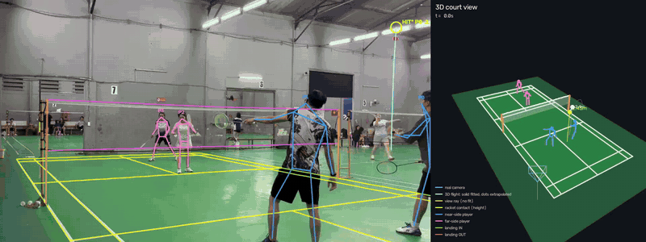

# badminton-analysis

Phân tích video cầu lông quay bằng **một điện thoại đặt trên tripod**: dựng lại sân chuẩn BWF trong
video, theo dõi quả cầu, nhận diện người chơi và cú chạm vợt, rồi **khôi phục đường bay 3D của cầu
bằng vật lý** — tất cả từ một camera duy nhất.



▶ Bản nét hơn: [docs/demo.mp4](docs/demo.mp4) (0–22 s của `danh-cau`).
Trái: video gốc với sân, khung xương, vệt cầu (đỏ), đường bay 3D chiếu ngược vào ảnh (xanh, nét liền
= có dữ liệu, chấm = ngoại suy) và cú chạm vợt (`HIT`, `HIT*` = cú bị bỏ sót đã khôi phục).
Phải: cảnh 3D — sân, lưới, camera thật, người chơi 3D, đường bay 3D kèm độ cao, điểm chạm, điểm rơi.

---

## Mục lục

1. [Cài đặt và chạy](#1-cài-đặt-và-chạy)
2. [Tổng quan pipeline](#2-tổng-quan-pipeline)
3. [Thuật toán chi tiết](#3-thuật-toán-chi-tiết)
   - [3.1 Hệ toạ độ sân](#31-hệ-toạ-độ-sân)
   - [3.2 Nền sân trống bằng trung vị](#32-nền-sân-trống-bằng-trung-vị-background)
   - [3.3 Calibration camera từ vạch sân](#33-calibration-camera-từ-vạch-sân-calibrate)
   - [3.4 Phát hiện cầu bằng TrackNetV3](#34-phát-hiện-cầu-bằng-tracknetv3-detect)
   - [3.5 Theo dõi đường bay trên ảnh](#35-theo-dõi-đường-bay-trên-ảnh-track)
   - [3.6 Người chơi: pose và nâng lên 3D](#36-người-chơi-pose-và-nâng-lên-3d-pose-players)
   - [3.7 Cú chạm vợt](#37-cú-chạm-vợt-hits)
   - [3.8 Đường bay 3D bằng vật lý](#38-đường-bay-3d-bằng-vật-lý-flight)
   - [3.9 Điểm rơi](#39-điểm-rơi-landing)
   - [3.10 Phân tích trận](#310-phân-tích-trận-analytics)
   - [3.11 Render](#311-render-render)
4. [Kết quả và độ tin cậy](#4-kết-quả-và-độ-tin-cậy)
5. [Giới hạn và hướng tiếp theo](#5-giới-hạn-và-hướng-tiếp-theo)
6. [Tham khảo](#6-tham-khảo)

---

## 1. Cài đặt và chạy

```bash
python -m venv .venv
.venv/Scripts/python -m pip install -r requirements.txt
.venv/Scripts/python -m pip uninstall -y onnxruntime          # rtmlib kéo bản CPU vào, làm hỏng GPU
.venv/Scripts/python -m pip install --no-deps onnxruntime-gpu==1.23.2
git clone https://github.com/alenzenx/TrackNetV3.git third_party/TrackNetV3      # chỉ cần cho detector cũ
git -C third_party/TrackNetV3 checkout d1d96f39d275970d3597a45926f4f46e6ee85e2c
```

Những thứ không nằm trong git (`data/`, `models/`, `outputs/`):

| File | Nguồn |
|---|---|
| `models/tracknetv3_official/ckpts/TrackNet_best.pt` | **detector mặc định**: TrackNetV3 chính thức (qaz812345/TrackNetV3, MIT, kể cả trọng số), `TrackNetV3_ckpts.zip` trên Google Drive id `1CfzE87a0f6LhBp0kniSl1-89zaLCZ8cA`. Kiến trúc được khai báo lại trong `badminton/shuttle_v3.py`, nạp bằng `weights_only=True`, không chạy code ngoài |
| `models/tracknet_v3.pt` | detector cũ (`"detector": "alenzenx"` trong config): `model_best.pt` — Google Drive trong README của `alenzenx/TrackNetV3` |
| `models/pose/yolox_x_humanart.onnx` | `yolox_x_8xb8-300e_humanart-a39d44ed.zip` trên download.openmmlab.com (rtmlib, mode `performance`) |
| `models/pose/rtmpose_x_body7_384x288.onnx` | `rtmpose-x_simcc-body7_pt-body7_700e-384x288-71d7b7e9_20230629.zip` (cùng nguồn) |
| `data/videos/<tên>.mp4` | video của bạn |

Chạy toàn bộ:

```bash
.venv/Scripts/python -m badminton configs/danh-cau-02.json
```

Mỗi bước ghi kết quả vào `outputs/<tên config>/` và được **cache**: lần sau bỏ qua.
`--force <bước...>` để tính lại, `--only <bước...>` để chỉ chạy vài bước. Cần `ffmpeg` trong PATH
để xuất H.264 có âm thanh. Pipeline chạy headless nên đặt được trên máy GPU từ xa
(điện thoại upload video → máy GPU xử lý → tải kết quả).

### Thêm video mới

```json
{
  "video": "data/videos/<tên>.mp4",
  "floor_top": 300,
  "ignore": [[850, 480, 1024, 576]],
  "seeds": [
    [[0, -1.98], [88, 408]],
    [[3.05, -1.98], [430, 373]],
    [[3.05, -6.7], [930, 479]],
    [[0, -6.7], [524, 780]]
  ]
}
```

- `seeds`: ≥ 4 cặp `[toạ độ sân (m), pixel]`, ước lượng thô là đủ. Pixel **được phép nằm ngoài khung
  hình** (giao điểm suy từ phương trình 2 vạch nhìn thấy). Tránh dồn các điểm sát nhau trên một vạch.
- `floor_top`: phía trên hàng pixel này không có sàn. `ignore`: hình chữ nhật bỏ qua (logo, watermark).
- Sau bước `calibrate`, mở `court_overlay.png`: vạch vàng phải nằm trên vạch trắng. Dời tripod = config mới.

---

## 2. Tổng quan pipeline

```
video ──► background ──► calibrate ─────────────────────────────┐
  │        (trung vị)     (sân chuẩn ↔ vạch trắng → K, R, t)      │
  │           │                                                  ▼
  ├────► detect ──► track ──────────────► hits ──► flight ──► landing ──► analytics ──► render
  │      TrackNetV3  multi-target          ▲       vật lý 3D    vật lý +    loại cú,      video +
  │      (nền + 8    + chọn đường bay      │       + khôi phục  vật trắng   tốc độ, thế   cảnh 3D
  │       frame)                           │       cú bị sót    nằm yên     đứng, P1..P4
  └────► pose ──► players ─────────────────┘
         YOLOX-x   chân → sàn (homography), khớp → 3D,
         RTMPose-x danh tính P1..Pn theo màu áo/quần
```

| Bước | Đầu ra | Thời gian* |
|---|---|---|
| `background` | `background.png` | ~4 s |
| `calibrate` | `calib.json`, `court_overlay.png` | < 1 s |
| `detect` | `candidates.csv` | ~195 fps (TrackNetV3 chính thức, stride 4) |
| `track` | `shuttle.csv`, `court_volume.png` | < 1 s |
| `pose` | `pose.npz` | ~10 fps (chậm nhất) |
| `players` | `players.csv` (+ cột `player` = P1..Pn), `players_k3d.npy` | ~15 s |
| `hits` | `hits.json` | < 1 s |
| `flight` | `flights.json` | ~1.5 phút |
| `landing` | `landings.json` | ~40 s |
| `analytics` | `report.json`, `report.md` (tiếng Việt) | < 1 s |
| `render` | `<tên>_3d.mp4` | ~1 phút |

\* RTX 5060 Ti 16 GB, video 1024×576–1280×720, 30 fps, 2–2.5 phút.

Mã nguồn: `badminton/` — `court.py` (hình học sân), `background.py`, `calibrate.py`, `shuttle_v3.py`
(detector mặc định), `shuttle.py` (detector cũ), `track.py`, `players.py`, `identity.py` (P1..Pn),
`hits.py`, `flight.py`, `landing.py`, `analytics.py` (loại cú, tốc độ, thế đứng, báo cáo), `render.py`,
`__main__.py` (pipeline). Bộ đo có đáp án: `tools/synth_eval.py` (mục 4).

---

## 3. Thuật toán chi tiết

### 3.1 Hệ toạ độ sân

Đơn vị mét, sân đôi BWF 13.4 × 6.1 m:

- **X** ngang sân: 0 = biên đôi trái, 6.1 = biên đôi phải (biên đơn ở 0.46 và 5.64).
- **Y** dọc sân: 0 = lưới, âm = nửa sân phía camera, dương = nửa bên kia.
  Giao cầu ngắn ±1.98, giao cầu dài (đôi) ±5.94, đường cuối ±6.7.
- **Z** hướng lên từ mặt sàn. Lưới cao 1.55 m ở cột, 1.524 m ở giữa, mép dưới 0.79 m.

### 3.2 Nền sân trống bằng trung vị (`background`)

Camera đứng yên nên mỗi pixel phần lớn thời gian nhìn thấy sàn; người chơi thì luôn di chuyển.
Lấy 60 frame **rải đều cả video** và tính trung vị theo thời gian cho từng pixel, từng kênh màu:

```python
frames = [read(i) for i in np.linspace(0, n - 1, 60).astype(int)]   # (60, H, W, 3)
bg = np.median(np.stack(frames), axis=0)
```

- Trung vị chứ không phải trung bình: trung bình để lại "bóng ma" mờ của người, trung vị thì không
  miễn là mỗi pixel bị che **dưới một nửa** số frame.
- Rải đều chứ không lấy frame liên tiếp: trong vài giây liên tiếp người gần như đứng yên.
- Giới hạn: ai đứng một chỗ quá nửa thời gian vẫn để lại bóng mờ.

Nền này được dùng cho calibration (vạch không bị người che) và cho bước tìm vật trắng nằm yên.

### 3.3 Calibration camera từ vạch sân (`calibrate`)

Mục tiêu: tìm phép chiếu từ toạ độ sân (mét) sang pixel, rồi suy ra **tiêu cự** và **vị trí/hướng
camera** — không cần bảng caro hay thông số điện thoại.

1. **Mặt nạ vạch trắng:** HSV với độ bão hoà < 60 và độ sáng > 170. Sàn bóng phản chiếu đèn thành
   những mảng sáng to; giữ lại **nét mảnh** bằng *white top-hat*: `mask − open(mask, 11×11)`.
2. **Bản đồ khoảng cách:** `distanceTransform` — mỗi pixel biết khoảng cách tới vạch trắng gần nhất.
3. **Homography khởi đầu** từ các điểm `seeds` (≥ 4, bình phương tối thiểu `findHomography`).
4. **Tinh chỉnh (chamfer matching):** lấy mẫu 120 điểm trên mỗi vạch của mô hình sân chuẩn, chiếu bằng
   H, đo khoảng cách tới vạch trắng thật (cắt ngưỡng 12 px). Tối ưu 8 tham số của H bằng Powell:

   ```
   cost(H) = mean(min(dist(H·p), 12))  +  0.05 · Σ max(‖H·seed − seed_px‖ − 25, 0)
   ```

   - Điểm nằm **sau camera** (toạ độ thuần nhất w ≤ 0) bị bỏ, nếu không phép chiếu bị lật.
   - Số hạng thứ hai **neo** nghiệm gần các seed: không có nó, bộ tối ưu có thể co cả sân lại đè lên
     một vạch duy nhất (cost ≈ 0 nhưng vô nghĩa — đã gặp thật ở video 02).
5. **Tiêu cự từ homography của mặt sàn.** Với điểm chính ở tâm ảnh và pixel vuông,
   `A = T·H` (T dời gốc về tâm ảnh), hai cột đầu h₁, h₂ của A tỉ lệ với hai trục xoay r₁, r₂ (vuông góc):

   ```
   f² = −(h₁ₓ·h₂ₓ + h₁ᵧ·h₂ᵧ) / (h₁𝓏·h₂𝓏)
   ```

6. **Tư thế camera:** `solvePnP` với K vừa tìm và lưới điểm trên sàn → R, t; vị trí camera `C = −Rᵀt`.

**Kiểm chứng:** camera ra cao 1.32 m và 1.12 m (đúng tầm tripod), đứng sau đường cuối sân lệch ra
ngoài biên ~1 m; chiều cao người chơi tính ra 1.4–1.75 m (mục 3.6) — một phép kiểm tra độc lập.

### 3.4 Phát hiện cầu bằng TrackNetV3 (`detect`)

**Mặc định: TrackNetV3 chính thức** (Chen & Wang, MMAsia 2023, `qaz812345/TrackNetV3`). Mạng U-Net nhận
**ảnh nền trung vị + 8 frame liên tiếp** (27 kênh RGB, 512×288) và xuất 8 heatmap. Ảnh nền cho mạng biết
cái gì đứng yên (vạch trắng, đèn, logo) nên nó chỉ còn phải tìm vật nhỏ đang bay. Các cửa sổ chồng
nhau (bước 4 frame) được lấy trung bình ("temporal ensemble" như bài báo). 11.3 M tham số, 28 GFLOP/frame
(bản alenzenx: 15.1 M, 134 GFLOP/frame), ~195 fps trên RTX 5060 Ti.

So với detector cũ (TrackNetV2 + CBAM của alenzenx, 3 frame) trên video 02, đo ở cuối chuỗi xử lý:

| | Frame thấy cầu (sau track) | Đường bay 3D đạt chuẩn | Điểm cầu được vật lý giải thích |
|---|---|---|---|
| alenzenx, 3 frame | 2567 | 106 | ~1960 |
| **chính thức, 8 frame + nền** | **2863** | **120** | **~2385 (+22%)** |

Như bản cũ: giữ **mọi** vùng > 0.5 của heatmap (toạ độ, diện tích, điểm cao nhất), không chỉ vùng lớn
nhất, để bộ theo dõi tự chọn cầu của sân mình. Module InpaintNet (nắn quỹ đạo) của bài báo không dùng:
vật lý ở bước `flight` làm việc đó tốt hơn và có thước đo mét.

### 3.5 Theo dõi đường bay trên ảnh (`track`)

1. **Khối không gian sân:** chiếu hộp `[−1.5, 7.6] × [−8.2, 8.2] × [0, 10] m` vào ảnh (bỏ điểm sau
   camera, lấy bao lồi); ứng viên ngoài vùng này bị loại. *Ghi chú:* khi camera đứng sát mép sân,
   vùng này phủ kín khung hình nên không loại được gì — nó chỉ có ích khi camera đặt xa sân.
2. **Multi-target tracking:** mỗi đường bay đang sống dự đoán vị trí kế tiếp
   `p̂ = p_last + v·gap`; gán ứng viên gần nhất trong cổng `30 + 18·gap` px (tham lam, cặp gần nhất
   trước). Vận tốc làm mượt `v ← ½v + ½v_new`. Ứng viên không khớp mở đường bay mới — nhờ vậy cầu sân
   bên có đường bay **riêng** thay vì cướp đường bay của ta. Mất dấu quá 5 frame thì đóng.
3. **Lọc:** bỏ đường bay < 8 điểm hoặc di chuyển < 40 px (đèn trần, khung cửa, giày trắng).
4. **Chọn:** mỗi frame giữ một đường bay có điểm `mật độ × độ dài` cao nhất; lấp chỗ mất dấu ≤ 5 frame
   bằng nội suy tuyến tính.

### 3.6 Người chơi: pose và nâng lên 3D (`pose`, `players`)

- **Pose 2D:** YOLOX-x (tìm người) + RTMPose-x 384×288 (17 khớp COCO) qua `rtmlib`/ONNX Runtime GPU.
  Chọn bản lớn nhất vì ưu tiên độ chính xác (~10 fps).
- **Vị trí trên sân:** chân chạm sàn ⇒ trung điểm hai cổ chân (+4 px tới đế giày) qua `H⁻¹` cho ra
  (X, Y) **chính xác**.
- **Nâng các khớp lên 3D:** giả sử thân người nằm trên **mặt phẳng đứng đi qua chân, quay về phía
  camera** (pháp tuyến n = hướng ngang từ camera tới chân). Tia nhìn qua pixel của khớp
  `P(t) = C + t·d` cắt mặt phẳng tại

  ```
  t = n·(F − C) / (n·d)
  ```

  Cho độ cao đầu, cổ tay… theo mét. Kém chính xác khi tay vươn thẳng về phía/ra xa camera.
- **Đoạn theo dõi:** ghép giữa các frame bằng Hungarian trên khoảng cách vị trí sàn (ngưỡng 1.2 m).
  Đoạn này vỡ liên tục khi người che nhau (~100 đoạn cho 4 người), nên chỉ dùng nội bộ.
- **Danh tính P1..Pn (`identity.py`):**
  1. Đặc trưng ngoại hình: histogram HSV (16 hue × 4 saturation + 6 độ sáng) của **áo** (vai → hông)
     và **quần** (hông → gối) từ khung xương, chuẩn hoá Hellinger, cộng độ tương phản cục bộ (áo hoa
     văn khác áo trơn cùng màu).
  2. Số người mỗi bên = số người đứng trên nửa sân xuất hiện nhiều nhất (1 = đơn, 2 = đôi). k-means
     toàn video (không tách theo bên, nên vẫn đúng khi hai đội đổi sân giữa các ván).
  3. Mỗi frame gán bằng Hungarian: khoảng cách ngoại hình + phạt "dịch chuyển" (> 7 m/s là không thể).
     Người không giống ai (khán giả, sân bên) để trống.
  Kết quả: video 02 gán được 97.5% lần phát hiện, 91 lần nghi tráo trên ~16 600 (0.5%); video 01:
  95.3%, 26 lần. Kiểm bằng ảnh cắt từng người rải đều theo thời gian. Đã thử "bỏ phiếu theo đoạn
  theo dõi": tệ hơn (đoạn theo dõi không sạch như giả định) nên bỏ.
- Giữ người tới **2.5 m sau đường cuối** (± 1.2 m hai bên hông): cầu cao hay được đánh từ sau vạch.
- **Kiểm tra:** chiều cao (đầu + 0.12 m) ra 1.53–1.75 m ở video 02 — khớp người thật.

### 3.7 Cú chạm vợt (`hits`)

1. **Thời điểm ứng viên:** đầu **và cuối** mỗi đường bay, và các điểm mà hướng bay trên ảnh **đổi > 50°**
   hoặc tốc độ **tăng > 2.5×** (so 3 frame trước/sau). Điểm cuối cần thiết vì lúc vợt chạm cầu thường
   rơi vào khoảng TrackNet mất dấu vài frame (nhòe, vợt che): track mới bắt đầu đã cách vợt ~200 px,
   còn track cũ kết thúc ngay ở vợt.
2. **Kiểm tra 3D:** tia nhìn tới cầu `C + t·d` phải đi **gần cổ tay** của ai đó (±3 frame). Khoảng
   cách điểm–tia: `‖(W − C) − ((W − C)·d)·d‖ < 1.0 m` (đầu vợt cách cổ tay ~0.6 m).
3. **Ai đánh?** Một camera nhìn người gần và người xa chồng lên nhau, nên tia nhìn thường đi gần cổ tay
   của **cả hai**, và cổ tay gần nhất hay là người sai. Vì vậy giữ ứng viên tốt nhất **của mỗi bên**, rồi
   chọn bên bằng quy hoạch động (Viterbi) trên cả pha cầu: chi phí = khoảng cách cổ tay, cộng 0.8 nếu
   cùng một bên đánh 2 cú liền (chỉ xảy ra khi có cú bị sót ở giữa). Bước `flight` còn khớp vật lý cho
   cả hai bên và **đổi người đánh** nếu bên kia khớp tốt hơn.
4. **Điểm chạm** = điểm trên tia gần cổ tay đã chọn ⇒ **độ cao điểm chạm từ một camera**.
5. **Luật chơi:** gộp ứng viên trong 8 frame; một bên không đánh hai lần liên tiếp (< 20 frame);
   "chạm" dưới 0.25 m là nhặt cầu, bị bỏ.

Người chơi được giữ nếu đứng trong sân ± 1.2 m ở hai bên hông và **± 2.5 m sau đường cuối** (cầu cao
thường được đánh từ sau vạch cuối; giới hạn 1.2 m cũ loại mất người đánh).

Âm thanh (tiếng vợt) đã thử nhưng không dùng: cả hai video đều lẫn nhạc nền/tiếng sân khác
(~3 "tiếng tách" mỗi giây).

### 3.8 Đường bay 3D bằng vật lý (`flight`)

**Mô hình cầu lông** — lực cản bậc hai (Cohen et al., 2015):

```
dv/dt = g − (g / V∞²) · |v| · v,     V∞ ≈ 6.7 m/s (vận tốc rơi giới hạn)
```

Đường bay **không phải parabol**: rời vợt gần như thẳng, phanh rất gắt, rồi rơi gần như thẳng đứng.
Tích phân RK4, 4 bước con mỗi frame (viết bằng số thực thuần Python — nhanh hơn numpy 5–10× cho
vector 3 chiều, vì bộ tối ưu gọi hàng chục nghìn lần). Kiểm tra: thả rơi 3 s → 6.70 m/s.

**Vì sao một camera đủ:** mỗi cú có **7 ẩn**: vị trí + vận tốc lúc chạm, và **t₀ = lúc chạm lệch bao
nhiêu so với frame được phát hiện** (±1.5 frame). Mỗi frame cho **2 phương trình** (pixel x, y) ⇒ 10–30
frame là thừa dữ kiện. t₀ quan trọng: cú đập 80 m/s đi 1.3 m trong nửa frame, ghim lúc chạm vào ranh
giới frame làm lệch cả tốc độ lẫn chiều sâu (bộ đo có đáp án: sai số tốc độ trung vị 8.9% → 5.4%). Trọng lực đã biết cho **thước đo tỉ lệ thật** mà
một camera thuần tuý không có.

**Bài toán tối ưu** cho mỗi cú (từ cú chạm này tới cú chạm sau):

| Số hạng | Ý nghĩa |
|---|---|
| `π(P(tᵢ)) − pxᵢ` | sai số chiếu lại (pixel) mọi quan sát TrackNet |
| `(p₀ − contact) / 0.25 m` | bắt đầu ở điểm chạm vợt (mục 3.7) |
| `(P(t_next) − contact_next) / 0.4 m` | tới được vợt của cú sau (nếu có) |
| `min(Z, 0) / 0.05` | không chui xuống sàn |
| `max(1.524 − Z_lưới, 0) / 0.05` | **mọi** đường bay cắt mặt phẳng lưới giữa hai cột phải qua trên mép lưới |
| `10` nếu không cắt | cú đổi bên phải sang được bên kia |

- Hàm mất mát **soft-L1** (f_scale 6 px) để điểm nhiễu không kéo lệch.
- **Giới hạn cứng:** điểm chạm cao 0.3–3.5 m, vận tốc ≤ 120 m/s, và **điểm xuất phát nằm trong ±1.2 m
  quanh điểm chạm vợt**. Ràng buộc cuối rất quan trọng: soft-L1 áp lên *mọi* số hạng, kể cả số hạng
  neo, nên khi điểm đầu lệch xa thì neo bị coi là "nhiễu" và mất tác dụng. Khi đó nghiệm trượt dọc
  tia nhìn, ra đường bay khớp pixel rất đẹp nhưng xuất phát cách người đánh vài mét, và bị cổng
  "good" loại. Ví dụ: cú phông cao từ sau cuối sân ở t = 3.2 s video 02 xuất phát giữa sân, lệch 5 m.
- **Cầu bay ra khỏi mép trên khung hình rồi rơi lại** (cầu cao) vẫn là cùng một cú: khoảng trống đó không
  cắt đường bay, và nửa rơi xuống là phần ràng buộc vật lý tốt nhất.
- **Khởi tạo đa điểm:** lưới 3 hướng × 5 góc nâng × 4 tốc độ (6–40 m/s); chọn 4 điểm đầu tốt nhất để
  tối ưu (`least_squares`, trust-region) — tránh cực tiểu địa phương.
- **Cổng chất lượng ("good"):** trung vị chiếu lại < 6 px, > 70% điểm trong 8 px, ≥ 8 quan sát,
  điểm đầu lệch neo < 1.5 m, tốc độ < 360 km/h.
- **Hai cú dính nhau** (một cú chạm bị sót ở giữa): nếu chỉ phần đầu khớp, cắt ở chỗ 3 điểm liên tiếp
  lệch > 8 px và khớp lại phần đầu. Nếu khớp tổng thể hỏng hẳn (không chỉ ra được chỗ cắt), **khớp cửa sổ
  tăng dần** 10, 14, 20, 28, 40 điểm từ cú chạm và giữ cửa sổ dài nhất còn đạt chuẩn.
- **Cú nhanh, ngắn** (tạt, chặn: 5–10 frame) đạt chuẩn với ≥ 5 quan sát nếu có neo ở vợt người đỡ
  (bình thường ≥ 8); trường `confidence` = `medium`.
- Đường bay đi **dưới lưới** bị loại, kể cả khi khớp pixel đẹp: thường là người chơi trả cầu qua gầm
  lưới giữa các pha.
- **Kiểm tra phần ngoại suy:** sau điểm quan sát cuối, nếu cầu thật lệch > 25 px khỏi đường dự đoán
  2 frame liên tiếp ⇒ cầu đã bị đánh ⇒ **cắt đường bay** ở đó và bỏ điểm rơi ngoại suy.
- **Khôi phục cú bị sót:** các đoạn quan sát chưa được cú nào giải thích ("mồ côi") được cắt tại các
  điểm đổi hướng gấp; mỗi mảnh nhận một cú chạm suy luận — hoặc **vị trí 3D dự đoán ở cuối cú trước**
  (nếu cú trước vừa bị cắt), hoặc cổ tay gần tia nhìn nhất với cổng nới 1.6 m — rồi khớp, lặp lại.
  Đã thử neo "lỏng" vào người gần nhất khi không có cổ tay nào gần: khớp pixel rất đẹp nhưng **sai**
  (điểm chạm dính trần 3.5 m, tốc độ ~13 km/h — nghiệm trượt dọc tia nhìn) ⇒ đã bỏ.

### 3.9 Điểm rơi (`landing`)

Hai nguồn độc lập:

1. **Vật lý:** cú cuối của mỗi pha (không có cú chạm sau) được tích phân tới Z = 0. Ghi lại số giây
   ngoại suy sau lần cuối thấy cầu; > 0.5 s hiển thị dấu `?`.
2. **Vật trắng nằm yên:** TrackNet không thấy cầu đứng yên, nên tìm vật trắng nhỏ **mới xuất hiện** so
   với nền, nằm yên ≥ 0.5 s, cách điểm cuối một đường bay đang rơi ≤ 45 px, xuất hiện trong ~0.7 s sau
   đó. Phân biệt với giày/băng gối trắng: **phía trên quả cầu là sàn trống** (cột ngay trên blob có
   < 25% pixel khác nền), còn trên giày luôn là chân người; nhiều ứng viên thì chọn **nhỏ nhất**
   (cầu ~7 cm, giày ~28 cm ở cùng độ sâu). Ưu tiên chính xác hơn đầy đủ.

### 3.10 Phân tích trận (`analytics`)

Mọi chỉ số tính trên **3D có đơn vị mét** (đường bay vật lý, người trên mặt sàn), thứ mà theo dõi 2D
không có. Xuất `report.json` (đầy đủ, kèm heatmap 0.5 m cho mỗi người) và `report.md` (tiếng Việt).

**Từng cú** (mỗi đường bay đạt chuẩn, ≥ 10 km/h):

| Loại | Luật (theo thứ tự) |
|---|---|
| giao cầu | cú đầu tiên của pha |
| đập | chạm ≥ 1.9 m, ≥ 110 km/h, góc bay < 5° (cắm xuống hoặc phẳng mạnh) |
| phông cao / lốp | đỉnh ≥ 3 m và về cuối sân đối phương; chạm ≥ 1.6 m là phông, thấp hơn là lốp |
| lốp | chạm < 1.3 m, góc > 15°, cầu lên > 0.6 m, về giữa/cuối sân (hoặc đỉnh ≥ 2.8 m) |
| cầu lưới / chặn | về phần trước sân, chạm < 1.8 m, < 60 km/h, đỉnh < 2.6 m; người đánh gần lưới là cầu lưới |
| bỏ nhỏ | chạm ≥ 1.6 m, cầu không lên thêm, về trước/giữa sân, < 110 km/h |
| tạt | gần như phẳng, ≥ 50 km/h, chạm 0.6–2.2 m |
| đẩy / chặn | còn lại |

Kèm theo: **tốc độ rời vợt** và tốc độ trung bình (cầu mất nửa tốc độ trong ~0.2 s đầu), góc bay, độ
cao điểm chạm (trên đầu / ngang người / dưới thấp so với chiều cao người đánh), đỉnh, độ cao qua lưới,
thời gian bay, thẳng / chéo sân (> 15°), vùng tới (trước / giữa / sau), **thuận tay / trái tay**,
**bật nhảy**.

- *Tay cầm vợt* của mỗi người: ở các cú trên cao, tay giơ cao hơn trên ảnh. (Cổ tay gần tia nhìn nhất
  ở từng cú không dùng được: hai cổ tay thường đều gần tia nhìn.)
- *Thuận / trái tay* tính trên **ảnh 2D**: chiếu cổ tay cầm vợt lên trục vai trái → vai phải của chính
  người đó; cùng phía vai của tay đó = thuận tay, vắt qua thân = trái tay. Tính trong 3D thì sai số chiều
  sâu của điểm chạm (vài chục cm, nằm ngang sân với camera đặt ở góc) quyết định kết quả.
- *Bật nhảy*: cả cổ chân và hông cao hơn trên ảnh so với 0.25–0.6 s trước, > 7% chiều cao cơ thể (ước lượng).
- *Người đánh* chưa được định danh ở đúng frame chạm (vd. đang nhảy, chân rời sàn nên vị trí lệch) lấy
  danh tính của chính đoạn theo dõi đó trong ±15 frame.

**Từng người:** quãng đường di chuyển, tốc độ di chuyển trung bình / tối đa (p99), % thời gian ở trước /
giữa / sau nửa sân, vị trí trung tâm, heatmap; **tư thế chờ lúc đối thủ chạm cầu** (dang chân ≥ 22%
chiều cao và gối chùng ≤ 165°: kỹ thuật "split step"); **phản ứng** (từ lúc đối thủ chạm cầu tới khi bắt
đầu chạy > 1.5 m/s, chỉ tính khi đang gần như đứng yên); **về vị trí** (từ cú của mình tới khi về trong
1 m quanh vị trí trung tâm); số cú theo loại, tốc độ đập TB / max, số cú bật nhảy.

**Từng pha:** pha kết thúc khi cầu chạm sàn (bước `landing`) hoặc nghỉ > 3 s; bên thắng = người đánh
cú cuối nếu rơi IN, bên kia nếu OUT.

### 3.11 Render (`render`)

- **Video:** sân + lưới 3D chiếu vào ảnh, khung xương (xanh = phía camera, hồng = phía xa), vệt cầu,
  đường bay 3D chiếu ngược (đối chiếu trực quan với vệt đỏ), cú chạm, điểm rơi.
- **Cảnh 3D:** camera ảo quay chậm quanh sân (phía camera thật), sân, lưới trong suốt, frustum camera
  thật, người que 3D, đường bay (nét liền đã bay / chấm ngoại suy), quả cầu kèm độ cao và bóng chiếu
  xuống sàn, tia nhìn khi chưa có đường bay khớp.
- Xuất H.264 + âm thanh gốc qua ffmpeg.

---

## 4. Kết quả và độ tin cậy

### Bộ đo có đáp án (`tools/synth_eval.py`)

Mô phỏng 6 loại cú bằng vật lý cầu lông, nhìn qua **camera thật đã calib** của từng video, rồi làm xấu dữ
liệu giống thực tế: nhiễu 2 px, mất 12% frame, mất 3 frame ngay sau cú chạm (nhòe / vợt che), 3% điểm
nhiễu xa, cầu ra khỏi khung, neo cổ tay lệch 0.2 m, **lúc chạm lệch tới 1 frame**. Chỉ giữ cú qua lưới.

```bash
.venv/Scripts/python tools/synth_eval.py outputs/danh-cau-02/calib.json --n 30
```

Camera video 02 (cao 1.12 m, sau đường cuối), 172 cú:

| Cú | Đạt chuẩn | Sai số 3D trung vị / p90 | Sai số tốc độ rời vợt trung vị / p90 | Điểm rơi | Sai số ≤ 1σ / 2σ báo ra |
|---|---|---|---|---|---|
| Phông cao | 100% | 11 / 42 cm | 3.5 / 8.7% | 1 cm | 92 / 100% |
| Đập | 90% | 18 / 61 cm | 6.2 / 18% | 10 cm | 70 / 85% |
| Bỏ nhỏ | 100% | 10 / 27 cm | 3.5 / 13% | 4 cm | 93 / 100% |
| Lốp | 100% | 4 / 21 cm | 3.2 / 7.3% | 3 cm | 88 / 92% |
| Tạt | 100% | 35 / 72 cm | 5.3 / 20% | 23 cm | 83 / 87% |
| Cầu lưới | 100% | 16 / 31 cm | 4.7 / 14% | 13 cm | 97 / 100% |
| **Tất cả** | **98%** | **13 / 49 cm** | **4.3 / 14%** | **8 cm** | **88 / 94%** |

Camera video 01 (cao 1.32 m): tất cả 99% đạt chuẩn, 3D 12 / 43 cm, tốc độ 4.4 / 12%, điểm rơi 7 cm.

Những gì bộ đo này đã quyết định:

| Thay đổi | Trước → sau (tất cả cú) |
|---|---|
| Thêm ẩn t₀ (lúc chạm giữa hai frame) | sai số tốc độ trung vị 8.9% → 5.4%, p90 25% → 17% |
| Cho cú ngắn có neo cuối đạt chuẩn với ≥ 5 quan sát | tỉ lệ đạt chuẩn 90% → 99% (tạt 69% → 96%) |
| Ghim độ cao điểm chạm ±0.6 m (ngang ±1.2 m), trần 3.2 m | bỏ được các cú "chạm" ở trần 3.5 m trên dữ liệu thật |

**Độ bất định tốc độ (σ)** lấy từ hiệp phương sai Gauss-Newton tại nghiệm; trên bộ đo, sai số thật nằm
trong ±1σ ở 88% số cú, trong ±2σ ở 94%, tức σ hơi thận trọng. Trong báo cáo, tốc độ có σ > 10% được đánh
dấu `~` và không tính vào thống kê đập. Đó gần như luôn là cú **bay dọc hướng nhìn của camera** (cuối sân
xa → về phía camera): chiều sâu gần như không đổi pixel, và vì lực cản, quãng đường chỉ tăng theo log của
tốc độ (180 so với 280 km/h ≈ 1.7 m trong 0.4 s), nên pixel không xác định được tốc độ. Vị trí và độ cao
của các cú đó vẫn tốt.

### Dữ liệu thật (chưa có đáp án)

| | `danh-cau` (1280×720, nhiều sân) | `danh-cau-02` (1024×576, 1 sân) |
|---|---|---|
| Camera | X −0.77, Y −6.35, cao 1.32 m | X −0.97, Y −7.64, cao 1.12 m |
| Người chơi | 4 (đôi), 95% lần phát hiện được định danh | 4 (đôi), 97% |
| Cú chạm phát hiện | 56 → 84 | 98 → 131 |
| Đường bay 3D đạt chuẩn | 39 → **79** (46 trực tiếp + 33 khôi phục) | 88 → **127** (111 + 16) |
| Sai số chiếu lại (trung vị) | 1.9 px | 1.1 px |
| Điểm TrackNet được vật lý giải thích (< 8 px) | 30% → **62%** | 62% → **86%** |
| Cú có tốc độ đo tốt (σ < 10%) | 28 / 77 | 74 / 125 |
| Tốc độ rời vợt (trung vị / max, cú đo tốt) | 61 / 220 km/h | 79 / 252 km/h |
| Điểm rơi | 11 | 6 |

*Trước → sau đợt sửa 2026-11-09. `danh-cau` thấp hơn vì thấy cả sân bên cạnh, cầu của sân đó không thuộc
về ai. Ở video 02, trong 14% điểm chưa giải thích có gần một nửa là cầu đứng yên (trên sàn, trên tay); tính
riêng cầu đang bay thì ~91% được giải thích.*

**Đối chiếu độc lập:** pha 51.3 s của `danh-cau` — vật lý dự đoán rơi ở (1.74, 2.15); quả cầu thật xác
nhận bằng mắt trên sàn ở khoảng (1.5–1.7, 1.7–2.6) ⇒ lệch ~0.3–0.5 m. Danh tính P1–P4 kiểm bằng ảnh cắt
từng người rải đều theo thời gian; thuận tay / tay cầm vợt và người đánh ở vài cú đập kiểm bằng mắt.

## 5. Giới hạn và hướng tiếp theo

- **Một camera không phân biệt được cầu sân mình với cầu sân bên** nằm trên cùng tia nhìn
  (`danh-cau`: hai điểm OUT lệch 1.5–2.5 m sang sân phải nhiều khả năng là cầu sân bên).
- **Tốc độ cú bay dọc hướng nhìn** (cuối sân xa → camera) không đo được chính xác (mục 4); báo `~`.
  Máy quay đặt **ngang lưới** hoặc cao hơn nhiều sẽ biến chiều sâu đó thành chuyển động ngang trên ảnh.
- **Còn ~25–33 lần "cùng bên đánh 2 cú liền"** mỗi video: cú chạm bị sót mà không khôi phục được.
- **Loại cú theo luật** (chưa có dữ liệu gán nhãn để học / đo): ranh giới đẩy / chặn / tạt / bỏ nhỏ là
  mềm. Hướng tiếp: gán nhãn vài trăm cú và đo, hoặc dùng mô hình học từ ShuttleSet (vd. BST, 2025) với
  đặc trưng 3D ở đây làm đầu vào.
- **Thuận / trái tay, bật nhảy, tư thế chờ** là ước lượng từ khung xương 2D, kiểm bằng mắt vài trường hợp.
- **Danh tính** dựa vào màu áo: hai người mặc giống nhau thì chỉ còn vị trí để phân biệt.
- **Pose chậm** (~10 fps): gộp lô pose theo frame, chạy detector mỗi 3–5 frame, TensorRT FP16
  → dự kiến 30–50 fps mà không giảm chất lượng.
- **30 fps** và nhạc nền làm thời điểm chạm cầu lệch vài frame (ẩn t₀ bù được trong ±1.5 frame).

**Bước tiếp theo: 2 camera để có đáp án thật.** Hai tia nhìn nên gần **vuông góc** (60–120°):

```
            sân đối thủ
   ┌──────────────────────┐
   │                      │
 ──┼──────── lưới ────────┼──   ◀── Máy B: ngang lưới, cách biên 3–5 m, cao nhất có thể
   │                      │
   └──────────────────────┘
              ▲
     Máy A: sau đường cuối sân, cao 1.5–2 m+
```

Không đặt hai máy ở **hai góc chéo đối diện**: chúng nhìn dọc cùng một đường chéo từ hai phía, tia nhìn
gần như trùng phương ⇒ triangulation kém. Quay 60 fps, khoá lấy nét/phơi sáng, ống 1x, vỗ tay hoặc
nháy flash trước mỗi lần quay để đồng bộ, không chèn nhạc. Từ đó: triangulation → đáp án 3D thật →
đo sai số của phương pháp một camera ở trên.

---

## 6. Tham khảo

- C. Cohen, B. Darbois Texier, D. Quéré, C. Clanet — *The physics of badminton*, New Journal of Physics 17 (2015).
- P. Liu, J.-H. Wang — *MonoTrack: Shuttle trajectory reconstruction from monocular badminton video*, CVPR Workshops 2022.
- Y.-C. Huang et al. — *TrackNet: A deep learning network for tracking high-speed and tiny objects in sports applications*, AVSS 2019.
- Y.-J. Chen, Y.-S. Wang — *TrackNetV3: Enhancing ShuttleCock Tracking with Augmentations and Trajectory
  Rectification*, ACM MMAsia 2023. Code + trọng số (MIT): https://github.com/qaz812345/TrackNetV3 (detector mặc định)
- TrackNetV3 bản alenzenx (detector cũ): https://github.com/alenzenx/TrackNetV3
- J.-Y. Chang — *BST: Badminton Stroke-type Transformer for Skeleton-based Action Recognition in Racket Sports*, 2025.
- T. Jiang et al. — *RTMPose: Real-time multi-person pose estimation based on MMPose*, 2023; rtmlib: https://github.com/Tau-J/rtmlib
- Z. Ge et al. — *YOLOX: Exceeding YOLO series in 2021*, 2021.
